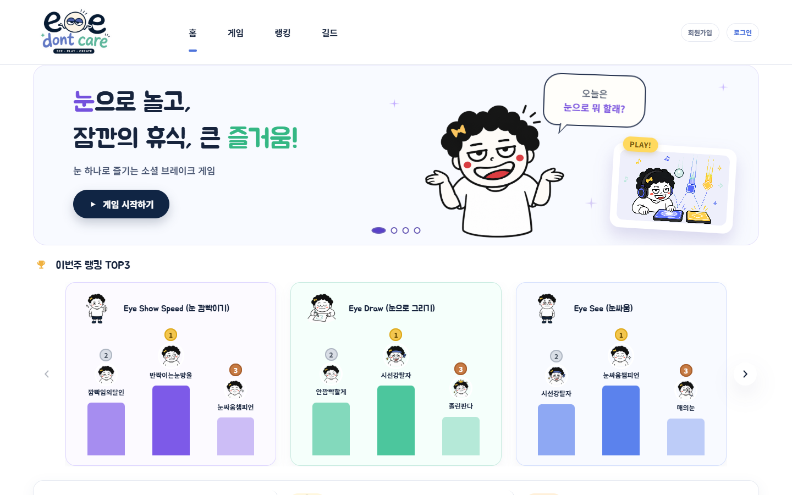
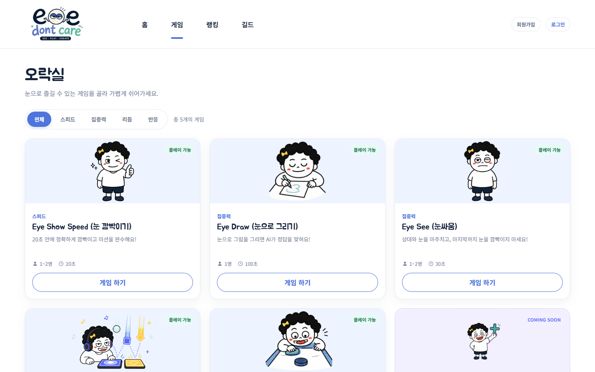

# 👁️ 아이돈케어 (eye-dont-care)

> **눈이 곧 컨트롤러입니다. 웹캠 하나로 즐기는 눈싸움 게임 웹 플랫폼.**
> **Project Date:** 2026.07.15 ~ 2026.08.10 · **6인 팀 프로젝트**
> **Platform:** 웹 (Vue 3 + TypeScript) · Spring Boot API · PostgreSQL · Redis
> **Role:** 백엔드 REST API 설계 및 데이터 파이프라인 구축 (전체 575커밋 중 152커밋, 팀 저장소 기준)
> **Live Demo:** <https://eye-dont-care.pages.dev> (백엔드 없이 브라우저 안의 목(mock) 백엔드로 동작)

설치도 전용 장비도 없이 브라우저에서 바로 접속해, **웹캠으로 인식한 시선과 눈 깜빡임**으로 조작하는 미니게임 5종을 즐기는 웹 서비스입니다. 게임 한 판은 약 1분이고, **주간 랭킹과 대결**로 다시 찾아오게 만드는 것을 목표로 했습니다.

눈 추적 추론은 전부 브라우저(MediaPipe)에서 끝나고, 서버는 **매칭·대기방·게임 세션 중계와 기록·랭킹**을 맡습니다. 랜덤 매칭은 분산 락 없이 **Redis 원자 연산으로 상대를 예약한 뒤 확정**하는 흐름으로 설계했습니다.

---

## 📱 실제 화면

| 홈 | 오락실 |
|:---:|:---:|
|  |  |
| 게임 시작 진입점과 이번 주 랭킹 TOP3 | 눈으로 하는 미니게임을 골라 바로 시작 |

> 화면은 [라이브 데모](https://eye-dont-care.pages.dev)에서 찍은 것입니다. 랭킹·길드 화면은 로그인이 필요해 넣지 않았습니다.

---

## 📖 프로젝트 개요

눈으로 하는 게임은 보통 전용 시선 추적 장비나 설치형 프로그램이 필요합니다.
아이돈케어는 그 진입 장벽을 **웹캠 + 브라우저**만으로 낮췄습니다.

* **설치 없이** — 웹캠을 허용하면 바로 플레이, 눈 추적 추론은 전부 클라이언트에서 수행
* **가입 없이** — 비회원도 게스트 세션으로 바로 플레이, 회원은 이메일·카카오 로그인
* **혼자서도 함께도** — 혼자하기(랭킹 반영) · 친구와 대결(초대코드) · 랜덤 매칭 · AI 대결(일부 게임)

### 🎮 미니게임 5종

| 게임 | 이름 | 조작 | 설명 |
|---|---|---|---|
| 🏒 `air` | **Eye Hockey** (에어 하키) | 시선 + 깜빡임 | 시선으로 말렛을 움직이고 눈을 깜빡여 퍽을 타격 |
| 👀 `hold` | **Eye See** (눈싸움) | 눈 뜨고 버티기 | 먼저 감는 쪽이 패배하는 생존 시간 승부 |
| ✏️ `draw` | **Eye Draw** (눈으로 그리기) | 시선 | 시선으로 제시어를 그리면 AI(Vision 모델)가 채점 |
| 🎵 `rhythm` | **Blink the Beat** (리듬 게임) | 깜빡임 | 흘러오는 비트에 맞춰 눈을 깜빡여 콤보 |
| ⚡ `blink` | **Eye Show Speed** (눈 깜빡이기) | 깜빡임 | 제한 시간 안에 더 많이, 더 빠르게 깜빡이기 |

### 💡 주요 기능

| 기능 | 설명 |
|---|---|
| 👁️ **웹캠 눈 추적** | MediaPipe FaceLandmarker 기반 시선 추정·깜빡임 인식. 전용 장비 없이 추론은 전부 브라우저에서 수행 |
| ⚔️ **실시간 멀티플레이** | WebSocket 매칭·대기방·게임 세션, LiveKit(OpenVidu) 기반 상대 캠 화면 공유 |
| 🏆 **주간 랭킹** | 게임별 최고 기록/승수 집계(KST 월요일 리셋, 동점은 선착순), 게임 종료 시 순위 변동(상승·하락) 표시 |
| 📜 **경기 기록** | 최근 경기 목록과 상세(점수·플레이 시간·함께한 상대 스코어보드) |
| 👥 **길드(커뮤니티)** | 길드 생성·검색·코드 입장, 게시판(후기·댓글) |
| 🔑 **회원/게스트** | 이메일·카카오 로그인(JWT), 비회원도 게스트 세션으로 바로 플레이 |
| 🤖 **AI 채점** | 눈으로 그리기 결과를 GPT-4o Vision으로 판정 |

---

## 🏗️ 아키텍처

눈 추적은 프레임마다 도는 연산이라 서버로 영상을 보내지 않고 **브라우저에서 추론을 끝내고**, 서버는 REST(기록·랭킹·길드)와 WebSocket(매칭·대기방·게임 세션)만 담당하도록 나눴습니다.

```text
브라우저 (Vue 3 + MediaPipe 눈 추적 — 추론은 전부 클라이언트에서)
   │  REST /api/v1/**        WebSocket /ws/**         WebRTC(캠 공유)
   ▼                              ▼                        ▼
Nginx ──────────────▶ Spring Boot Backend ◀──────────▶ LiveKit
                          │           │
                     PostgreSQL     Redis
                    (기록·랭킹·길드) (게스트 세션·매칭)
                          │
                   dbt · Airflow (야간 배치: 감사 + 분석 마트)
```

백엔드 도메인: `auth` `user` `guest` `game` `gameresult` `gamesession` `matchmaking` `waitingroom` `ranking` `group`

**요청 흐름 (랜덤 매칭 신청 → 게임 결과 반영)**

1. 브라우저가 랜덤 매칭을 신청하면 서버는 참가자 상태와 게임별 대기 큐를 Redis에 등록
2. 대기 순서가 빠른 두 명을 예약해 대기방을 만들고, `/ws/match` WebSocket으로 `MATCH_SUCCESS`를 푸시
3. 두 참가자가 대기방(`/ws/waiting-rooms/{id}`)에서 준비를 마치면 게임 세션(`/ws/game-sessions/{id}`)으로 넘어가 실시간 이벤트를 중계
4. 게임이 끝나면 결과를 REST로 제출하고, 게임마다 다른 경기 결과를 PostgreSQL **JSONB** 단일 스키마(`{슬롯: {score}}`)로 적재
5. 주간 랭킹과 순위 변동을 계산해 결과 화면에 표시

> 방 생성은 대기방 도메인을 부르는 외부 호출이라, 그 사이 락을 잡고 있으면 상대 도메인의 지연이 매칭 전체의 지연이 됩니다. 그래서 분산 락 대신 **원자 연산으로 예약하고 실패하면 되돌리는** 구조로 결정했습니다.

### 데이터 파이프라인 (dbt + Airflow)

게임 결과를 **감사(reconcile) + 분석(analytics)** 하는 야간 배치 ELT입니다. 서빙은 운영 DB를 직접 읽는 실시간 경로라, 배치는 서빙 경로에 끼지 않습니다.

```text
운영 public                dbt (analytics 스키마)
 games_results ─┐   stg_game_results ─┐
 games ─────────┘                     ├─▶ fact_game_play ─┬─▶ agg_user_game_stats   [분석]
 participants_ ──▶ stg_participants ──┘   (score 컬럼)     └─▶ game_daily_stats       [분석]
 (game_result JSONB) ───────────────────▶ reconcile_score  (사본 vs 원본 대조)        [감사]
```

* `reconcile_score`: 실시간 서빙용 `participants_.score` 사본과 `game_result` JSONB 원본을 대조해 불일치만 남김 (`MISSING` → 안전 백필 후보, `MISMATCH` → 사람 검토)
* Airflow DAG `game_analytics_pipeline`: 매일 KST 03:00에 `dbt run → dbt test → data_quality_check` 순서로 실행

### 라이브 데모 구성

운영 서버는 프로젝트 종료 후 내렸습니다. 정적 호스팅만으로 서비스를 체험할 수 있도록, `frontend/src/demo/`가 `fetch`와 `WebSocket`을 가로채 **브라우저 안에서 백엔드 계약을 그대로 흉내 냅니다.** 앱 코드(API 모듈, 페이지, 스토어)는 데모 여부를 모릅니다.

* 혼자하기·AI 대결 5종은 실제 MediaPipe 눈 추적으로 플레이하고, 결과·신기록·주간 랭킹은 방문자의 브라우저에 저장
* 눈싸움·눈 깜빡이기·리듬 게임은 **데모 봇**을 상대로 랜덤 매칭·친구 대결 가능 (매칭 큐는 실서버 설계를 자료구조로 옮김)
* 에어하키 대결, 상대 캠 공유, 카카오 로그인은 실서버 전용이고, 눈으로 그리기 AI 채점은 시뮬레이션 결과를 반환
* MediaPipe 스레드 WASM에 필요한 COOP/COEP 응답 헤더를 설정할 수 있어 Cloudflare Pages에 배포

---

## 🔀 랜덤 매칭 설계 — 예약 → 확정 → 보상

매칭 큐는 게임별 Redis **Sorted Set**(member = 참가자, score = 신청 시각), 참가자 상태는 **Hash**로 관리합니다. 여러 요청이 동시에 들어와도 같은 참가자가 두 매칭에 잡히지 않도록 단계마다 원자 연산과 재검증을 두었습니다.

| 단계 | 처리 | 막는 문제 |
|---|---|---|
| **신청** | 상태 Hash 생성과 큐 등록을 **Lua 스크립트 하나**로 실행. 이미 신청한 참가자면 아무것도 바꾸지 않음 | 중복 신청, 상태만 있고 큐에는 없는 반쪽 등록 |
| **예약** | `ZPOPMIN`으로 대기 순서가 빠른 두 명을 한 번에 꺼내 `MATCHING`으로 표시하고 시도 식별자(`matchAttemptId`)를 부여. 두 명을 못 채우면 원래 score로 되돌림 | 두 요청이 같은 상대를 동시에 잡는 경쟁 조건 |
| **유령 정리** | TTL은 상태 Hash에만 걸리므로, 꺼낸 member 중 상태가 없거나 `SEARCHING`이 아닌 것은 버리고 다시 꺼냄 (재시도 상한 5회) | 만료된 참가자·이미 성사된 참가자와의 매칭 |
| **확정** | 대기방 생성 후 두 참가자가 여전히 같은 `matchAttemptId`로 예약돼 있는지 재검증하고 `ENTERING_ROOM`으로 전환, `MATCH_SUCCESS` 푸시 | 방 생성 중 한쪽이 취소했을 때의 부분 확정 |
| **보상** | 방 생성·확정이 실패하면 같은 시도로 예약된 참가자만 `SEARCHING`으로 다시 등록하고, 탈퇴 회원·만료 게스트는 정리 | 실패한 매칭에 참가자가 `MATCHING`으로 갇히는 문제 |
| **연결 종료** | 종료 이벤트가 **현재 등록된 WebSocket 세션의 것일 때만** 매칭 취소로 처리 | 이전 세션의 늦은 종료 이벤트가 새 매칭을 취소하는 문제 |

구현은 [`backend/.../matchmaking/`](backend/src/main/java/com/eyedontcare/backend/matchmaking/), 초기 설계안은 [`docs/design/matchmaking_Redis_키설계안.md`](docs/design/matchmaking_Redis_키설계안.md)에 있습니다.

---

## 📊 데이터 규모와 실측

| 단계 | 결과 |
|---|---|
| **개발 규모** | 팀 저장소 기준 전체 **575커밋** 중 본인 **152커밋** |
| **QA 대응** | 3차례 QA에서 접수된 피드백 **60건 이상**을 이슈 단위로 분해, 담당 백엔드 이슈 **약 20건** 수정·배포 |
| **릴리스** | 1.0.1 ~ 1.0.9 **총 9회**에 걸쳐 담당 도메인을 구현·안정화 |
| **야간 배치** | dbt 모델 6개(staging 2 · fact 1 · 분석 마트 2 · 감사 1)를 Airflow가 매일 1회 실행 |
| **데모 시드** | 회원 10명 · 길드 2개 · 경기 23건 (`deploy/seed-data/demo_seed_data.sql`을 데모용 인메모리 저장소로 옮김) |

---

## 🛠️ 기술 스택

| 영역 | 스택 |
|---|---|
| **클라이언트** |      MediaPipe FaceLandmarker · livekit-client |
| **백엔드** |    Spring Data JPA · Spring WebSocket · JWT(jjwt) · 카카오 OAuth · LiveKit Server SDK |
| **데이터** |     |
| **인프라** |     OpenVidu 3.x (single-node) |
| **협업** | 브랜치 전략(`main` ← `release/*` ← `dev` ← 작업 브랜치) · Conventional Commits · PR/Issue 템플릿 · AI 코딩 에이전트용 PR 전 검증 스킬(`.claude/skills/` · `.agents/skills/`) |

---

## 💥 트러블 슈팅

### 1. 동시 매칭 요청에서 같은 상대가 두 매칭에 잡혔다
* **현상:** 매칭 요청이 동시에 들어오면 한 참가자가 서로 다른 두 매칭의 상대로 잡힘.
* **원인:** 상대를 조회하는 시점과 확정하는 시점 사이에 다른 요청이 끼어드는 경쟁 조건.
* **해결:** Redis 원자 연산(`ZPOPMIN`)으로 상대를 먼저 예약(`MATCHING`)한 뒤 확정하는 흐름으로 바꾸고, 방 생성이나 확정이 실패하면 참가자를 대기 상태로 되돌리는 보상 로직을 추가.

### 2. 재접속 직후 새 매칭이 곧바로 취소됐다
* **현상:** 사용자가 다시 접속해 매칭을 신청하면 얼마 지나지 않아 신청이 취소됨.
* **원인:** 뒤늦게 끊긴 이전 WebSocket 세션의 종료 이벤트가 새 매칭의 취소로 처리됨.
* **해결:** 참가자마다 현재 활성 세션을 등록해 두고, 종료 이벤트가 그 세션의 것일 때만 매칭을 취소하도록 변경.

### 3. 상대 이탈과 정상 종료를 구분하지 못했다
* **현상:** 게임이 정상적으로 끝났는데도 상대가 이탈한 것으로 처리되어 몰수승이 표시됨.
* **원인:** 이탈과 정상 종료가 똑같은 연결 종료 이벤트로 들어옴.
* **해결:** 게임 세션에 종료 사유 상태를 두어 `GAME_OVER`를 먼저 보낸 세션의 소켓 종료는 정상 종료로 보고, 그렇지 않은 종료만 이탈로 판단해 몰수승 처리.

### 4. 성사된 참가자가 재신청하면 두 번째 방에 배정됐다
* **현상:** 이미 매칭이 성사된 참가자가 다시 신청하면 방이 하나 더 만들어짐.
* **원인:** 큐에서 빠진 참가자가 재신청으로 다시 큐에 들어가 후보로 뽑힘.
* **해결:** 후보를 선점할 때 상태가 `SEARCHING`이 아닌 member는 되돌리지 않고 버리도록 하고, 신청 단계에서도 기존 상태가 있으면 큐를 건드리지 않게 변경.

---

## 📂 디렉터리 구조

```text
eye-dont-care/
├── frontend/           # Vue 3 SPA — pages · components · composables · lib/games
│   └── src/demo/       # 라이브 데모용 브라우저 내 목 백엔드 (데모 빌드에서만 포함)
├── backend/            # Spring Boot API — 도메인별 패키지 구조
├── pipeline/
│   ├── dbt/            # staging → fact → 분석 마트 + reconcile_score 감사 모델
│   └── airflow/        # 야간 배치 DAG (game_analytics_pipeline)
├── docs/
│   ├── design/         # 설계·전달 문서 — 매칭 Redis 키, JSONB 스키마, 랭킹·길드 ERD, QA 정리
│   ├── planning/       # 팀 기획 산출물 — 기능 정의서 · API 명세서
│   ├── DEMO.md         # 라이브 데모 동작 원리 · 범위 · 배포 방법
│   └── *.md            # 팀 컨벤션 — 브랜치 · 커밋 · 코드 · PR
├── deploy/             # 배포 문서 — 빌드·배포 절차 · 외부 서비스 · 시연 시나리오 · 데모 시드
├── compose.dev.yml     # 로컬 개발 스택 (frontend · backend · postgres · redis)
├── compose.prod.yml    # 프로덕션 스택
└── Jenkinsfile         # CI/CD 파이프라인
```

---

## 🚀 실행 방법

**요구 사항:** Docker (전체 스택) · Node.js (프론트엔드·데모 빌드) · JDK 25 (백엔드 테스트)

```bash
docker compose -f compose.dev.yml up -d      # frontend :3000 · backend :8000 · postgres · redis
# http://localhost:3000
```

카카오 로그인, AI 채점(Vision API), 미디어 서버(LiveKit) 등 외부 연동 키는 환경변수로 주입합니다 (`.env.example`, [`deploy/external-services.md`](deploy/external-services.md)). 키가 없어도 서비스는 기동되며 해당 기능만 비활성됩니다.

### 라이브 데모 빌드 (백엔드 없이)

```bash
cd frontend && npm ci
npm run build:demo        # vite build --mode demo → dist/
npm run preview:demo      # 로컬 미리보기
```

### 테스트

```bash
cd frontend && npm test && npm run build   # Vitest + 타입체크 포함 빌드
cd backend && ./gradlew test               # JUnit (Redis·PostgreSQL 컨테이너 필요)
```

---

## 📚 문서

| 문서 | 내용 |
|---|---|
| [DEMO.md](docs/DEMO.md) | 라이브 데모 동작 원리 · 체험 범위 · 배포 방법 |
| [matchmaking_Redis_키설계안.md](docs/design/matchmaking_Redis_키설계안.md) | 랜덤 매칭 Redis 키 구조와 초기 설계안 |
| [gameResult_JSONB_스키마_제안.md](docs/design/gameResult_JSONB_스키마_제안.md) | 경기 결과 JSONB 단일 스키마 |
| [랭킹-ranking-ERD.md](docs/design/랭킹-ranking-ERD.md) · [소모임-group-ERD.md](docs/design/소모임-group-ERD.md) | 주간 랭킹 · 길드 ERD |
| [pipeline/README.md](pipeline/README.md) | dbt 모델과 Airflow 야간 배치 |
| [build-and-deploy.md](deploy/build-and-deploy.md) · [external-services.md](deploy/external-services.md) | 빌드·배포 절차 · 외부 서비스 연동 |
| [docs/design/](docs/design/) | QA 피드백 정리 등 설계·전달 문서 전체 |
| [CONTRIBUTING.md](CONTRIBUTING.md) | 브랜치 전략 · 커밋 · PR/Issue 규칙 |
