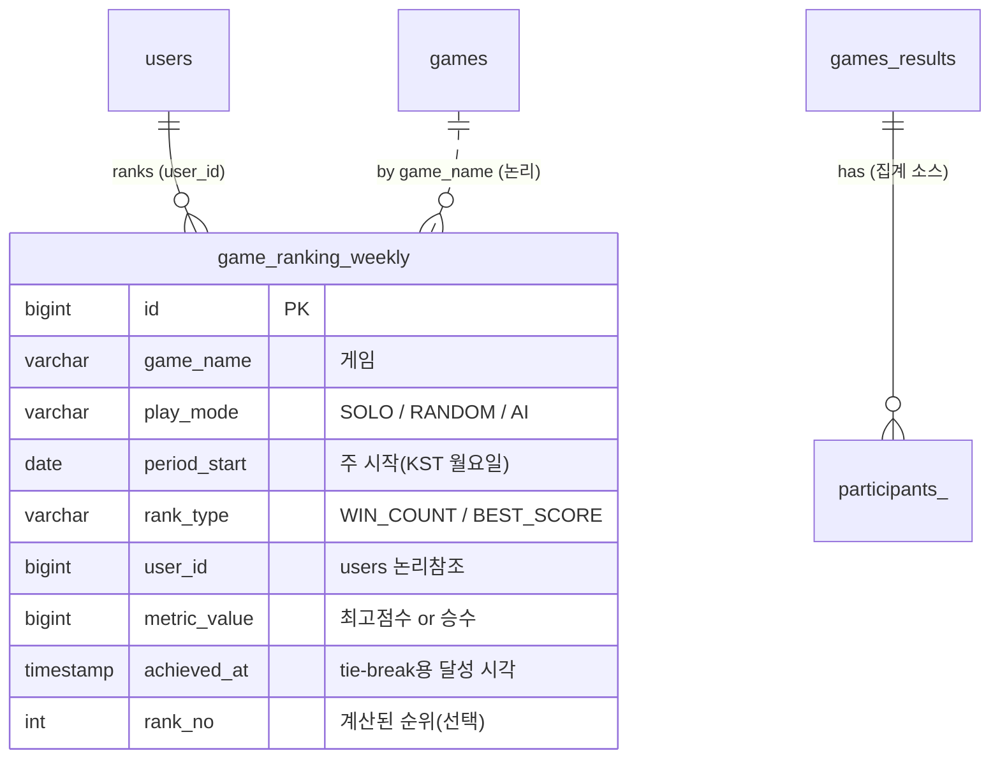

# 랭킹(Ranking) 도메인 ERD

작성: 매칭/게임/게임결과 담당 (랭킹 신규 설계)
기준: 주간 랭킹 · 동점 선착순 · 회원 전용

---

## 계약 요약
프론트 제출 JSONB는 게임 무관 통일 구조 `{ "<슬롯>": { "score": N } }`. 랭킹은 `game_result -> 슬롯 ->> 'score'`를 동일하게 읽는다.

| 게임 | 대상 모드 | rank_type | 랭킹이 읽는 값 | 단위 |
| --- | --- | --- | --- | --- |
| HOCKEY(에어하키) | RANDOM | `WIN_COUNT` | `participants_.outcome=WIN` 카운트 | win |
| EYEFIGHT(눈싸움) | SOLO | `BEST_SCORE` | `game_result[slot].score` (**초, 정수**) | second |
| DRAWING(그림) | AI | `BEST_SCORE` | `game_result[slot].score` | point |
| RHYTHM(리듬) | SOLO | `BEST_SCORE` | `game_result[slot].score` | point |
| BLINK(깜빡이) | SOLO | `BEST_SCORE` | `game_result[slot].score` | count |

- **주간**(KST 월요일 0시 리셋), **동점=선착순**(지표 desc, achieved_at asc)
- 유저의 slot은 `participants_.slot_no`로 찾아 그 슬롯의 score를 읽는다(혼자하기=slot 1).

---

## 두 가지 구현 방식

**MVP — 온-리드 계산 (새 테이블 없음)**
- 기존 `participants_`·`games_results`·`games`·`users`에서 **조회 시 계산**
- 이번 주(`ended_at` 필터) + 게임별 지표(JSONB 추출/outcome 카운트) + 정렬로 순위 산출
- 데이터 적을 때 충분. 랭킹 API가 바로 동작

**확장 — 사전집계 테이블 (파이프라인/스케줄러가 채움)**
- 아래 `game_ranking_weekly`에 주기적으로 집계 저장 → API는 이 테이블만 읽음(빠름)

---

## 다이어그램

---

## `game_ranking_weekly` (확장 시 도입)
| 컬럼 | 타입 | 제약 | 설명 |
| --- | --- | --- | --- |
| id | BIGINT | PK, auto | |
| game_name | VARCHAR(20) | NOT NULL | 게임 |
| play_mode | VARCHAR(20) | NOT NULL | 랭킹 대상 모드(SOLO/RANDOM/AI) |
| period_start | DATE | NOT NULL | **주 버킷 키**(KST 월요일). 주간 집계·리셋의 핵심 |
| rank_type | VARCHAR(20) | NOT NULL | `WIN_COUNT` / `BEST_SCORE` |
| user_id | BIGINT | NOT NULL | users 논리참조 |
| metric_value | BIGINT | NOT NULL | 최고 점수 or 승수(눈싸움은 초) |
| achieved_at | TIMESTAMP | NOT NULL | 동점 tie-break(먼저 달성 우선) |
| rank_no | INT | NULL | 사전계산 순위(조회 시 계산도 가능) |
| — | | UNIQUE(game_name, period_start, user_id) | 주·게임·유저 유일 |

- 순위 계산: `ORDER BY metric_value DESC, achieved_at ASC`
- `period_start`는 확장성 장치가 아니라 **주간을 성립시키는 필수 키**(없으면 전체 누적이 됨)

---

## 집계 소스 (기존 테이블 — 변경 없음)
- `games_results`: game_id, `game_result`(JSONB 통일 구조 `{슬롯:{score}}`), ended_at(주 필터)
- `participants_`: user_id, outcome(에어하키 WIN 카운트), rank_no
- `games`: game_id → game_name·play_mode 매핑
- `users`: nickname(표시)

> 랭킹 도메인은 소스 테이블을 **읽기만** 함. 기존 ERD 변경 없음.
