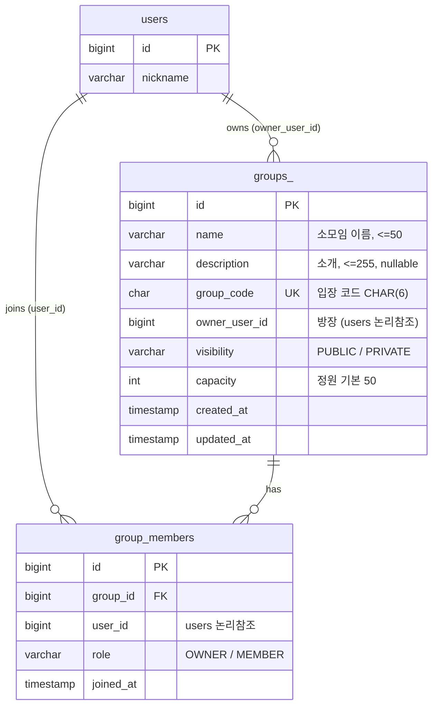

# 소모임(Group) 도메인 ERD

작성: matchmaking/game/gameResult 담당 (소모임 신규 개발)
기준 브랜치: `feat/backend-group` (dev 기준)
저장소: RDB(PostgreSQL) 영속. `users`는 논리 참조(참가자 테이블과 동일하게 FK 없이 컬럼만 유지)

---

## 다이어그램

---

## 테이블 상세

### `groups_`  (GROUPS는 SQL 예약어라 `participants_`처럼 언더스코어)
| 컬럼 | 타입 | 제약 | 설명 |
| --- | --- | --- | --- |
| id | BIGINT | PK, auto | |
| name | VARCHAR(50) | NOT NULL | 소모임 이름 |
| description | VARCHAR(255) | NULL | 소개 |
| group_code | CHAR(6) | NOT NULL, UNIQUE | 입장 코드(대문자+숫자) |
| owner_user_id | BIGINT | NOT NULL | 방장. users 논리참조 |
| visibility | VARCHAR(20) | NOT NULL | `PUBLIC`(목록 노출) / `PRIVATE`(코드로만) |
| capacity | INT | NOT NULL | 정원. 기본 50, 방장 포함 카운트 |
| created_at | TIMESTAMP | NOT NULL | BaseTimeEntity |
| updated_at | TIMESTAMP | NOT NULL | BaseTimeEntity |

### `group_members`
| 컬럼 | 타입 | 제약 | 설명 |
| --- | --- | --- | --- |
| id | BIGINT | PK, auto | |
| group_id | BIGINT | NOT NULL, FK→groups_.id | |
| user_id | BIGINT | NOT NULL | users 논리참조 |
| role | VARCHAR(20) | NOT NULL | `OWNER` / `MEMBER` |
| joined_at | TIMESTAMP | NOT NULL | 가입 시각 |
| — | — | UNIQUE(group_id, user_id) | 한 소모임 중복 가입 방지 |

---

## 규칙 요약
- **회원 전용**: 게스트는 소모임 불가(휘발성 세션).
- **공개/비공개**: `PUBLIC`만 목록·검색 노출, `PRIVATE`은 코드로만 입장.
- **방장(OWNER)**: 생성 시 자동으로 OWNER 멤버 등록. 방장은 **나갈 수 없고**(삭제해야 함), 삭제·강퇴 권한 보유.
- **정원**: 기본 50, 방장 포함. 초과 시 입장 거부.
- **삭제**: 방장이 삭제하면 `group_members`는 cascade 삭제.

---

## 다른 도메인과의 관계
- **users**: 방장/멤버가 회원 참조. `participants_.user_id`처럼 **FK 없이 컬럼만** 유지(users 제약은 추후).
- **waiting_room / game**: 직접 관계 없음. (추후 "소모임 안에서 방 만들기" 확장 시 연결 가능)
